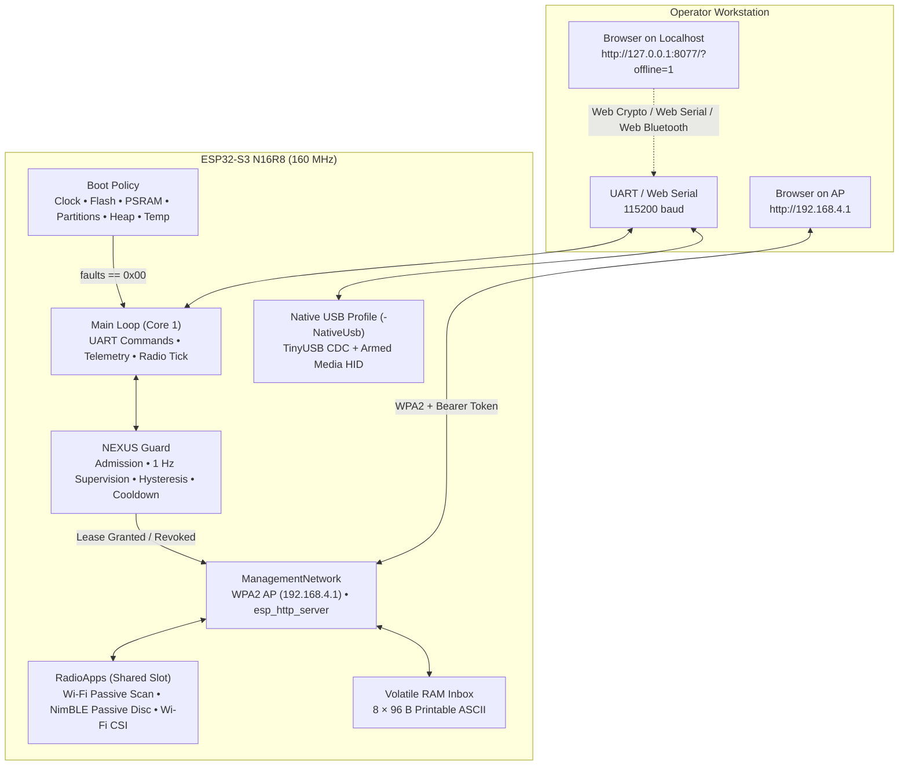
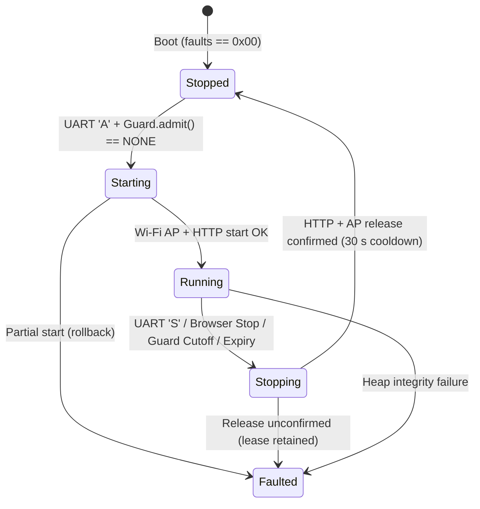

# NEXUS-GUARD (`NEXUS-S3`) — Complete Technical Documentation

> **Firmware Version:** `0.3.0-dev.1` (Standalone Field Mode + Full 12-App Suite)  
> **Target Hardware:** ESP32-S3 N16R8 (QFN56 rev v0.2, 16 MiB Flash, 8 MiB OPI PSRAM, 160 MHz qualified profile)  
> **Toolchain Baseline:** Arduino CLI `1.6.0` · ESP32 Arduino Core `3.3.12` · ESP-IDF `5.5.5` · esptool `5.3.1` · Xtensa GCC `2601`

---

## Table of Contents

1. [Overview](#1-overview)
2. [System Architecture](#2-system-architecture)
3. [Hardware & Partition Baseline](#3-hardware--partition-baseline)
4. [Boot Policy & Safe-Mode Protections](#4-boot-policy--safe-mode-protections)
5. [NEXUS Guard Supervision Policy](#5-nexus-guard-supervision-policy)
6. [Security & Ephemeral Authority Model](#6-security--ephemeral-authority-model)
7. [UART & Native USB Command Reference](#7-uart--native-usb-command-reference)
8. [Local HTTP API (`/api/v1`)](#8-local-http-api-apiv1)
9. [PocketOS & The 12-App Suite](#9-pocketos--the-12-app-suite)
10. [Build, Host Verification & Safe App-Only Flashing](#10-build-host-verification--safe-app-only-flashing)
11. [Qualification & Hardware Evidence Summary](#11-qualification--hardware-evidence-summary)
12. [Troubleshooting & Known Constraints](#12-troubleshooting--known-constraints)

---

## 1. Overview

**NEXUS-S3** is a local-first embedded firmware and self-hosted web console (**PocketOS**) designed for the ESP32-S3 N16R8. Rather than keeping radios or network services running continuously, NEXUS-S3 boots into a quiet `IDLE` state and activates its WPA2 management access point, HTTP API, and radio utilities strictly on operator demand under **NEXUS Guard** supervision.

Key goals:
- **Deterministic hardware safety**: Hard on-chip temperature cutoffs, internal heap and PSRAM reserves, contiguous-block minimums, session expiry, and mandatory cooldowns.
- **Zero cloud / zero secret persistence**: Ephemeral per-boot Wi-Fi passphrases and one-time per-session operator codes live only in RAM and are delivered exclusively over physical UART.
- **Clean separation of policy and SDK**: Pure C++17 policy modules (`boot_policy.h`, `guard.h`/`guard.cpp`, `radio_policy.h`, `stop_job.h`, `media_arm.h`) are compiled and tested natively on the host with MSVC `/W4 /WX` independently of ESP-IDF.
- **Framework-free PocketOS**: HTML, CSS, and vanilla JavaScript (`web/`) are compiled directly into the firmware image (`web_assets.h`) with strict Content-Security-Policy headers and responsive dark/light themes.

---

## 2. System Architecture



### Source Module Map

| File | Responsibility |
|---|---|
| `firmware/NexusS3/main.cpp` | Startup verification, `__wrap_initArduino()` override, 1 Hz Guard supervision loop, UART command dispatch |
| `firmware/NexusS3/boot_policy.h` | Pure C++17 startup capability bitmask checks |
| `firmware/NexusS3/hal.h`, `hal.cpp` | ESP32-S3 hardware sampling (clock, flash, PSRAM, temperature sensor, partition table check) |
| `firmware/NexusS3/guard.h`, `guard.cpp` | Pure C++17 `Guard` and `ManagementService` state machine |
| `firmware/NexusS3/stop_job.h` | 15-second cancellable browser shutdown job state machine |
| `firmware/NexusS3/radio_policy.h` | Shared thermal and memory admission gates for optional radio jobs |
| `firmware/NexusS3/radio_apps.h`, `radio_apps.cpp` | Single-slot bounded Wi-Fi passive scan, NimBLE passive discovery, and Wi-Fi CSI capture |
| `firmware/NexusS3/management.h`, `management.cpp` | WPA2 AP ownership, `esp_http_server` routing, constant-time auth, volatile inbox, event ring |
| `firmware/NexusS3/field_policy.h` | Pure C++17 Standalone Field credential rules, `:` command parser, and `FieldButton` state machine |
| `firmware/NexusS3/field_store.h`, `field_store.cpp` | Safe non-erasing NVS owner storing Field WPA2 passphrase & salted PBKDF2-HMAC-SHA256 verifier |
| `firmware/NexusS3/status_led.h`, `status_led.cpp` | Onboard RGB LED (`GPIO 48`) status indicator for eyes-free standalone operation |
| `firmware/NexusS3/media_arm.h`, `native_usb.h`, `native_usb.cpp` | Separate TinyUSB CDC + single-action armed HID consumer control (`-NativeUsb` profile) |
| `web/index.html`, `style.css`, `app.js`, `apps.js` | Embedded PocketOS dashboard, ChipVitals, Settings, and all 12 apps |
| `scripts/build.ps1` | Reproducible build pipeline, asset packager, partition-hash verifier, ELF symbol verifier |
| `scripts/provision-field.ps1` | Interactive masked PowerShell helper for provisioning or clearing Standalone Field Mode |
| `scripts/serve-local.mjs` | Zero-dependency loopback HTTP server for secure-context browser APIs (`127.0.0.1:8077`) |

---

## 3. Hardware & Partition Baseline

| Parameter | Qualified Specification |
|---|---|
| MCU | ESP32-S3 N16R8 (dual-core Xtensa LX7, silicon rev v0.2) |
| CPU Frequency | `160 MHz` (enforced at compile time via `#if F_CPU != 160000000L` and at boot) |
| Flash | `16 MiB` (`QIO 80 MHz` build profile / DIO image header) |
| PSRAM | `8 MiB` Octal (OPI) PSRAM |
| UART Bridge | CH343 USB-UART at `115200 baud` (management profile) |
| Native USB | ESP32-S3 USB-OTG (`USBMode=default`, `-NativeUsb` profile only; use one cable at a time) |
| Management AP | SSID `NEXUS-S3`, WPA2-PSK, Channel `1`, max `1` client, `8.5 dBm` TX power, RAM-only Wi-Fi storage |

### Partition Layout (`app3M_fat9M_16MB`)

Qualified partition table SHA-256: `ACE02503447D0F470692E65FA76002F2D77A92DC81CD3813D8AA66718D716DA9`

| Partition | Offset | Size | Usage in `0.2.0-dev.3` |
|---|---:|---:|---|
| `nvs` | `0x009000` | `0x005000` (20 KiB) | Deliberately left unopened (`__wrap_initArduino`) |
| `otadata` | `0x00E000` | `0x002000` (8 KiB) | Preserved; selects active app slot |
| `app0` | `0x010000` | `0x300000` (3 MiB) | Active firmware image (`1,116,016 B` management / `1,213,920 B` native USB) |
| `app1` | `0x310000` | `0x300000` (3 MiB) | Reserved OTA slot |
| `ffat` | `0x610000` | `0x9E0000` (9.875 MiB) | Retained untouched for future storage owner |
| `coredump` | `0xFF0000` | `0x010000` (64 KiB) | Preserved |

> [!NOTE]
> Because NVS is intentionally unopened, ESP-IDF 5.5.5 logs a PHY calibration-cache miss when Wi-Fi starts and automatically falls back to full RF calibration. This is expected and verified on hardware.

---

## 4. Boot Policy & Safe-Mode Protections

On every boot, `setup()` checks heap integrity (`heap_caps_check_integrity_all(true)`), generates the per-boot WPA2 passphrase before initializing RF/ADC stacks, initializes the on-chip temperature sensor, and evaluates `nexus::bootFaults(...)`. Any non-zero fault mask latches `SAFE_MODE` and refuses to enable management services.

| Bit | Hex Flag | Meaning |
|---:|---:|---|
| 0 | `0x01` | CPU clock differs from `160 MHz` |
| 1 | `0x02` | Physical flash size unavailable or `!= 16 MiB` |
| 2 | `0x04` | OPI PSRAM missing or `!= 8 MiB` |
| 3 | `0x08` | Partition table layout does not match the six qualified entries |
| 4 | `0x10` | Startup heap integrity check failed |
| 5 | `0x20` | On-chip temperature unavailable or outside `10–50°C` |
| 6 | `0x40` | Internal free heap `< 64 KiB` (`65,536 B`) |
| 7 | `0x80` | PSRAM free `< 1 MiB` (`1,048,576 B`) |

---

## 5. NEXUS Guard Supervision Policy



### Policy Thresholds (`guard-v1` / `0.2.0-dev.3`)

| Gate | Parameter | Threshold | Behavior on Breach |
|---|---|---:|---|
| **AP Admission** | On-chip temperature | `≤ 33.3°C` | Denied (`THERMAL_ADMISSION_DENIED`) |
| **AP Admission** | Internal free heap | `≥ 136 KiB` (`64 KiB` reserve + `72 KiB` headroom) | Denied (`HEAP_RESERVE`) |
| **AP Admission** | Internal largest block | `≥ 32 KiB` | Denied (`BLOCK_TOO_SMALL`) |
| **AP Admission** | PSRAM free | `≥ 1 MiB` | Denied (`PSRAM_RESERVE`) |
| **AP Admission** | Post-stop cooldown | `30 s` | Denied (`COOLDOWN`) |
| **Runtime Supervision** | Session thermal cutoff | `admitted_C + 10.0°C` (fixed for session) | Immediate stop (`THERMAL_CUTOFF`) |
| **Runtime Supervision** | Thermal warning (hysteresis) | Set at `cutoff - 2.0°C`, clears below `cutoff - 3.0°C` | Emits `THERMAL_WARNING`, blocks radio apps |
| **Runtime Supervision** | Hard memory reserves | `≥ 64 KiB` internal free, `≥ 1 MiB` PSRAM free | Immediate stop (`HEAP_RESERVE` / `PSRAM_RESERVE`) |
| **Runtime Supervision** | Session lifetime | `10 minutes` (`600,000 ms`) | Automatic stop (`SESSION_EXPIRED`) |
| **Optional Radio Apps** | Thermal margin | No warning & `< cutoff - 3.0°C` | Denied/cancelled (`RADIO_THERMAL_MARGIN`) |
| **Optional Radio Apps** | Memory margin (`0.2.0-dev.3`) | `≥ 128 KiB` internal free, `≥ 48 KiB` largest block, `≥ 1 MiB` PSRAM | Denied/cancelled (`RADIO_MEMORY_MARGIN`) |
| **Optional Radio Apps** | Request spacing | `12 s` cooldown after accepted job | Denied (`RADIO_COOLDOWN`); denials skip cooldown |

> [!IMPORTANT]
> **Why the radio heap floor is `128 KiB` in `0.2.0-dev.3`:** Hardware qualification on `0.2.0-dev.2` measured that initializing NimBLE alongside an active Wi-Fi AP + HTTP server drops internal free heap to `152,520 B` (~148.9 KiB) with ~84.2 KiB retained by NimBLE for the remainder of the boot. Lowering the optional-radio floor from `155 KiB` to `128 KiB` (`131,072 B`) preserves `2×` Guard's `64 KiB` internal reserve while giving Wi-Fi + NimBLE ~22 KiB of clean operating headroom.

---

## 6. Security & Ephemeral Authority Model

- **WPA2 AP Passphrase**: 32 lowercase hex characters (128 bits of hardware RNG entropy) generated once per boot before RF startup; never stored in NVS or flash.
- **One-Time Operator Code**: 32 lowercase hex characters generated fresh on every management start (`A`) and rotation (`K`). Exchanged **once** at `POST /api/v1/auth/session` (2-second rate limit between login attempts) and zeroized immediately after use (`mbedtls_platform_zeroize`).
- **Bearer Session Token**: 32 lowercase hex characters held only in browser memory (`expiresInSeconds: 300`), compared in constant time, and immediately invalidated on logout, rotation (`K`), or AP stop.
- **Strict HTTP Hardening**:
  - Enforces exact `Host: 192.168.4.1` on all requests and exact `Origin: http://192.168.4.1` on all mutations (`POST`, `PATCH`, `DELETE`).
  - Rejects `Transfer-Encoding` and limits request bodies to `32 B` (`96 B` exclusively for `POST /api/v1/inbox`).
  - Serves PocketOS with strict `Content-Security-Policy` (`default-src 'none'; script-src 'self'; style-src 'self'; connect-src 'self'; base-uri 'none'; form-action 'none'; frame-ancestors 'none'`).
  - Maximum 4 open sockets with 2-second recv/send timeouts and LRU purge enabled.

### Standalone Field Mode (Power Bank + Phone, No Laptop)
When provisioned once over UART (`./scripts/provision-field.ps1` or `:wifi` + `:pass`), `FieldStore` initializes NVS **without ever calling `nvs_flash_erase()`** and stores credentials exclusively in namespace `"nexus_field"`:
- **Field Wi-Fi WPA2 Password (`12–63` printable ASCII)**: Used for `NEXUS-S3` AP startup and redacted from UART logs (`WPA2 password <field-configured>`).
- **Field Operator Passphrase (`8–32` printable ASCII)**: Stored as a **48-byte verifier** (`16 B` random salt + `32 B` PBKDF2-HMAC-SHA256 at `10,000` rounds), never in plaintext. Accepted alongside the one-time 32-hex UART code at `POST /api/v1/auth/session` with constant-time comparison and 2-second rate limiting.
- **Physical `BOOT` Button (`GPIO 0`)**:
  - Locked out while held during power-on/reset; ignores short bumps (< 1.5 s) in idle.
  - **Hold 1.5 s in idle** → triggers Guard-supervised AP start (`MANAGEMENT START SOURCE BUTTON`).
  - **Short press (or hold) while running** → triggers immediate clean shutdown (`MANAGEMENT STOP SOURCE BUTTON`).
- **Onboard RGB LED (`GPIO 48`)**:
  - **Off** = `IDLE` · **Blue** = holding `BOOT` to start · **Green** = AP `RUNNING` · **Amber** = `THERMAL_WARNING` · **Red blink** = Guard denied start or fault · **Cyan flash** = Field credentials saved or cleared.
- Send `:clear` over UART (or `./scripts/provision-field.ps1 -Clear`) anytime to erase `"nexus_field"` and revert immediately to 100% ephemeral random-per-boot mode.

> [!WARNING]
> Keep UART transcripts private. In ephemeral mode they contain the active boot's WPA2 passphrase and one-time operator code. Always reboot before starting a new session if provisioning output was exposed.

---

## 7. UART & Native USB Command Reference

### Management Profile (`COM` / CH343 UART at `115200 baud`)

| Command | Mode | Effect & Expected Output |
|---|---|---|
| `A` | Idle | Runs heap check + Guard admission; starts AP/HTTP and prints `MANAGEMENT START NONE`, WPA2 password, URL, and one-time operator code |
| `S` | Running | Immediately stops management; logs `MANAGEMENT STOP SOURCE UART` and `MANAGEMENT STOP CONFIRMED` |
| `K` | Running | Revokes current bearer token and prints a new one-time operator code |
| `W` | Running | Queues one passive AirScope Wi-Fi scan (`RADIO WIFI UART QUEUED` → `RADIO WIFI DONE count=N`) |
| `?` | Any | Immediately prints a `STATUS uptime_ms=... cpu_mhz=160 on_chip_c=... internal_free=... psram_free=...` line |

### Native USB Profile (`-NativeUsb`, TinyUSB CDC at `115200 baud`)

Available only while management is stopped (`allowed == true`). Arming expires automatically after **15 seconds** or on CDC disconnect.

| Command | Action |
|---|---|
| `?` | Prints command help banner |
| `U` | Arms **one** media HID action for 15 seconds (`ARMED for one media action.`) |
| `P` | Sends Consumer Control **Play / Pause** (press + release) if armed, then disarms |
| `N` | Sends Consumer Control **Next Track** (press + release) if armed, then disarms |
| `B` | Sends Consumer Control **Previous Track** (press + release) if armed, then disarms |
| `X` | Immediately disarms (`DISARMED.`) |

---

## 8. Local HTTP API (`/api/v1`)

All JSON responses include `Cache-Control: no-store`. Errors return an HTTP status code with `{"error":{"code":"..."}}`.

### Public Read Endpoints (Inside Management AP)

| Method | Endpoint | Description |
|---|---|---|
| `GET` | `/`, `/style.css`, `/app.js`, `/apps.js` | Embedded PocketOS web console assets |
| `GET` | `/api/v1/system` | Chip, `firmwareVersion`, `buildId` (ELF SHA-256), `cores`, `resetReason` |
| `GET` | `/api/v1/telemetry` | Cached uptime, CPU clock, temperature, internal & PSRAM heap metrics, storage state, Guard summary |
| `GET` | `/api/v1/guard` | Policy version, service state, last reason/warning, `cutoffC`, heap & PSRAM reserves |
| `GET` | `/api/v1/services` | Management service state, dependencies, and internal headroom bytes |
| `GET` | `/api/v1/settings` | Redacted AP policy (`ssid`, `channel`, `clientLimit`, `txPowerDbm`, `pollSeconds`, `persistence`) |
| `GET` | `/api/v1/apps` | Board app registry and availability |
| `GET` | `/api/v1/events` | Most recent 8 redacted Guard/service events in RAM |

### Authentication & Operator-Authorized Endpoints

Require `Origin: http://192.168.4.1` on mutations and `Authorization: Bearer <32-hex-token>` (except login).

| Method | Endpoint | Body / Headers | Description |
|---|---|---|---|
| `POST` | `/api/v1/auth/session` | `text/plain` 32-hex code | Exchange one-time UART code for 5-minute bearer token |
| `DELETE` | `/api/v1/auth/session` | Empty | Revoke current operator session |
| `PATCH` | `/api/v1/settings` | `text/plain` `2`, `3`, or `5` | Set telemetry poll interval (seconds) for current boot |
| `POST` | `/api/v1/services/management/stop` | Empty | Queue browser shutdown (`HTTP 202`, 15 s cancellation window) |
| `GET` | `/api/v1/jobs/{id}` | — | Query queued stop job state and `remainingMs` |
| `POST` | `/api/v1/jobs/{id}/cancel` | Empty | Cancel queued stop job before deadline (`MANAGEMENT STOP CANCELLED`) |
| `POST` | `/api/v1/radio/wifi` | Empty | Queue bounded passive 2.4 GHz Wi-Fi scan (`HTTP 202`) |
| `POST` | `/api/v1/radio/ble` | Empty | Queue bounded passive NimBLE discovery (`HTTP 202`) |
| `POST` | `/api/v1/radio/csi` | Empty | Queue 3-second owned-link Wi-Fi CSI capture (`HTTP 202`) |
| `POST` | `/api/v1/radio/cancel` | Empty | Request cancellation of the active radio job (`HTTP 202`) |
| `GET` | `/api/v1/radio` | — | Latest radio job `kind`, `state`, `reason`, CSI aggregates, or discovery `rows` |
| `POST` | `/api/v1/inbox` | `text/plain` 1–96 printable ASCII | Append note to volatile 8-slot boot inbox (`HTTP 201`) |
| `GET` | `/api/v1/inbox` | — | Return up to 8 most recent notes from the current boot |

---

## 9. PocketOS & The 12-App Suite

PocketOS runs directly from the ESP32-S3 (`http://192.168.4.1`) for board-backed services, and from `node scripts/serve-local.mjs` (`http://127.0.0.1:8077/?offline=1`) for offline tools and browser APIs requiring a secure context.

### Board-Backed Apps
1. **AirScope** — Briefly switches Wi-Fi to `APSTA` without joining external networks to perform a bounded passive 2.4 GHz scan (up to 12 APs: SSID, channel, RSSI, security mode). Supports early queuing via UART `W` and **Load last scan** in the browser.
2. **BlueScope** — Initializes NimBLE on first use (remains resident for the boot) and performs a 2.5-second passive duplicate-filtered BLE discovery (advertised name + RSSI). On localhost, also provides explicit UUID-filtered read-only Web Bluetooth GATT characteristic reads.
3. **CyberDeck** — Runs live diagnostic checks against `/system`, `/telemetry`, `/guard`, and `/settings` with round-trip latency and clear error reporting when the board goes offline.
4. **DeadDrop** — Authenticated volatile RAM inbox retaining the 8 newest printable ASCII notes (≤ 96 bytes each) across operator code rotations (`K`) and same-boot AP restarts; cleared automatically on reboot.
5. **GhostSense** — 3-second experimental Wi-Fi CSI capture collecting up to 192 aggregate frame amplitude samples strictly attributed to the single connected AP client, with in-view baseline comparison.

### Localhost & Offline Browser Apps
6. **PocketVault** — Client-side note encryption using Web Crypto **PBKDF2-HMAC-SHA256** (`600,000` iterations, 16-byte random salt) + **AES-256-GCM** (12-byte random IV). Only verified ciphertext envelopes can be saved to `localStorage`.
7. **Toolbox** — Up to 4 KiB UTF-8 Base64, Hex (strict byte-pair validation), URL encoding/decoding, and Web Crypto SHA-256 digests on localhost.
8. **USB Studio** — Web Serial terminal (`115200 baud`, bounded 4 KiB rolling output) with explicit port selection, clean disconnect disposal, and one-click `?` board status readout.
9. **GhostLink** — Localhost Web Serial control panel for the separate `-NativeUsb` firmware profile, enforcing pair → arm (`U`) → single media action (`P`/`N`/`B`) → automatic disarm.
10. **SoundForge** — 8-step pentatonic Web Audio oscillator sequencer (`40–220 BPM`) with clean audio teardown on navigation and Standards-compliant Type 0 `.mid` (SMF) file export.
11. **PortalPlay** — Accessible offline 16-tile (8-pair) memory matching game with keyboard navigation, ARIA labels, mismatch flip-back delay, move counter, and restart.
12. **CyberArena** — Three offline defensive security exercises covering Base64 decoding, SHA-256 manifest integrity mismatch response, and least-privilege access control.

---

## 10. Build, Host Verification & Safe App-Only Flashing

### Reproducible Firmware Build

```powershell
# Management profile (COM/UART + Wi-Fi/BLE/CSI + PocketOS)
./scripts/build.ps1

# Native USB profile (TinyUSB CDC + Armed Media HID)
./scripts/build.ps1 -NativeUsb
```

`scripts/build.ps1` automatically:
1. Verifies Arduino CLI `1.6.0` and `esp32:esp32 3.3.12`.
2. Packages `web/{index.html,style.css,app.js,apps.js}` into `web_assets.h`.
3. Compiles with `-Wl,--wrap=initArduino` and `CPUFreq=160,FlashMode=qio,FlashSize=16M,PartitionScheme=app3M_fat9M_16MB,PSRAM=opi`.
4. Verifies the generated partition binary matches `ACE02503447D0F470692E65FA76002F2D77A92DC81CD3813D8AA66718D716DA9`.
5. Verifies the image fits within the `3,145,728 B` (`3 MiB`) app slot and that `__wrap_initArduino` replaced `initArduino` in the linked ELF.
6. Writes `manifest.json` with SHA-256 digests of the `.bin`, `.elf`, `.map`, and partition table.

### Host Test Suites

```cmd
:: Pure C++17 policy tests (MSVC x64 Developer Command Prompt)
if not exist build\host mkdir build\host
cl /nologo /std:c++17 /EHsc /W4 /WX /Fo:build\host\boot_policy_test.obj /Fe:build\host\boot_policy_test.exe tests\host\boot_policy_test.cpp
build\host\boot_policy_test.exe
cl /nologo /std:c++17 /EHsc /W4 /WX /Fo:build\host\ /Fe:build\host\guard_test.exe tests\host\guard_test.cpp firmware\NexusS3\guard.cpp
build\host\guard_test.exe
```

```powershell
# Headless Microsoft Edge desktop & mobile fixture suite
node tests/host/browser_test.mjs
```

### Safe App-Only Upload Procedure

> [!CAUTION]
> Do **not** use the generic Arduino IDE Upload button on qualified boards, as it can overwrite the bootloader, partition table, or OTA selector. Always verify live flash backups first and write **only** to `app0` (`0x10000`) using `esptool v5.3.1`.

```powershell
# 1. Inspect and validate the built application image first
& "$env:LOCALAPPDATA\Arduino15\packages\esp32\tools\esptool_py\5.3.1\esptool.exe" `
  --chip esp32s3 image-info .\build\<build-dir>\NexusS3.ino.bin

# 2. Write ONLY the application image to app0 (0x10000) after verifying backups
& "$env:LOCALAPPDATA\Arduino15\packages\esp32\tools\esptool_py\5.3.1\esptool.exe" `
  --chip esp32s3 --port COM3 --baud 115200 --before default-reset --after hard-reset `
  write-flash --flash-mode dio --flash-freq 80m --flash-size 16MB `
  0x10000 .\build\<build-dir>\NexusS3.ino.bin
```

---

## 11. Qualification & Hardware Evidence Summary

Full dated entries are maintained in [docs/qualification-register.md](docs/qualification-register.md).

| Area | Result | Verified Highlights (`0.2.0-dev.3`) |
|---|---|---|
| **Host Policy Suite** | **PASS** | `10/10` boot-policy tests + `51/51` Guard, StopJob, MediaArm, radio-policy, Field credentials, and `BOOT` button tests (`/W4 /WX`) |
| **Standalone Field Mode (`0.3.0-dev.1`)** | **PASS** | Non-erasing NVS (`nvs=ok`), `:wifi` + PBKDF2 `:pass` persistence across hardware reset, redacted UART AP line, Field Wi-Fi join, PBKDF2 Field passphrase unlock (`wrong=401`), clean `:clear` wipe, and `272,088 B` idle internal heap |
| **Browser Fixture Suite** | **PASS** | Desktop & 360 px mobile render, auth, stop/cancel, theme persistence, and all 12 app views |
| **Foundation Hardware Smoke** | **PASS** | Healthy `160 MHz` boot (`faults=0x00`), UART/HTTP telemetry parity, `401` auth enforcement, Settings mutation, browser stop cancellation & shutdown |
| **AirScope Hardware** | **PASS** | Cold UART `W` scan, authenticated HTTP POST scan, cached result retrieval, and `RADIO_USER_CANCELLED` |
| **BlueScope Hardware** | **PASS** | Cold passive BLE discovery (`done`, 2 rows), same-boot repeat + `RADIO_USER_CANCELLED`, link continuity, `MANAGEMENT STOP CONFIRMED`, ~84.2 KiB NimBLE resident footprint quantified |
| **CyberDeck Hardware** | **PASS** | Live identity, telemetry, Guard, and AP settings parity + offline failure verified after shutdown |
| **DeadDrop Hardware** | **PASS** | `401` unauth, `400` non-printable, oversize rejection, 9→8 ring wrap, UART `K` token revocation, and same-boot cross-AP-session retention |
| **GhostSense Hardware** | **PASS** | Repeated 3 s CSI captures (`140`, `122`, and `133` eligible frames), clean shutdown, **0 B internal heap drift** (`279,928 B`) across two back-to-back sessions |
| **Localhost App Suite** | **PASS** | PocketVault AES-GCM/PBKDF2 round-trip + tamper rejection, Toolbox NIST SHA-256, SoundForge valid 69 B SMF MIDI export, PortalPlay full 16-tile completion & reset, CyberArena 3-exercise flow |
| **Native USB (`GhostLink`)** | **PASS** | `0.2.0-dev.3` Native USB (`1,213,920 B`, ELF `2e47c03e3`) enumerated `USB Serial Device` + `VID_303A` HID Consumer Control; verified `?` help, pre-arm denial, single `U` → `P` action & auto-disarm, `X` disarm, and 15 s arm expiry |

---

## 12. Troubleshooting & Known Constraints

- **`RADIO_THERMAL_MARGIN` on manual Wi-Fi / BLE scans**: Once the Wi-Fi AP starts, the ESP32-S3 warms quickly (~28–29°C → ~35.3°C). Stop management (`S`), wait at least 30 seconds for cooldown + airflow cooling, and queue scans promptly after `A` (or use UART `W` for AirScope).
- **NimBLE resident footprint**: After the first BlueScope scan in a boot, NimBLE stays resident (~84.2 KiB internal RAM; idle temperature settles near ~32.3°C with external airflow). Reboot the board to reclaim NimBLE memory when switching back to clean idle baselines.
- **Unauthenticated or oversized POSTs closing TCP**: By design, `management.cpp` rejects unauthenticated or `>96 B` POST payloads without draining the request body (`ESP_FAIL`), preventing body-flooding and keep-alive desync; some HTTP clients observe a TCP reset alongside the rejection.
- **GhostSense CSI calibration**: Current CSI captures expose raw aggregate amplitude and frame counts as a signal experiment (`CSI-01`); cross-boot raw `mean` variation (`2` vs constant `96`) requires `wifi_csi_config_t` gain/scaling characterization before adding presence inference.
- **Storage (`FFat` / `NVS`)**: Intentionally idle in `0.2.0-dev.3` until dedicated storage ownership and schema qualification are complete (`STR-01`).
