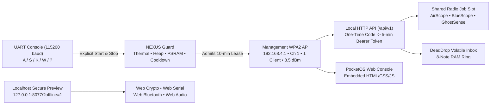

# NEXUS-GUARD (`NEXUS-S3`)

> Local-first, thermally and memory-guarded firmware and embedded web console (**PocketOS**) for the **ESP32-S3 N16R8**.


**NEXUS-S3** is a defensive, local-first embedded toolkit built around **NEXUS Guard** — a deterministic hardware safety supervisor that gates Wi-Fi, HTTP, BLE, and CSI radio workloads behind strict on-chip temperature, internal heap, PSRAM, and session-lifecycle budgets. There is no cloud dependency, no persistent credential storage, and no background radio activity on boot.

📖 **Read the complete technical manual in [DOCUMENTATION.md](DOCUMENTATION.md).**

---

## Architecture at a Glance



### Core Design Principles
- **Safe-by-default idle boot**: Boots to `IDLE` at `160 MHz`, verifies flash (`16 MiB`), OPI PSRAM (`8 MiB`), partition layout, heap integrity, and temperature sensor before accepting commands. NVS, FFat, Wi-Fi, BLE, HID, and MIDI stay idle.
- **Protected flash & NVS**: Replaces Arduino's default `initArduino()` startup hook (`-Wl,--wrap=initArduino`) so initialization errors never erase NVS; builds verify the exact `app3M_fat9M_16MB` partition table hash.
- **NEXUS Guard supervision**:
  - Cold management AP admission at `≤ 33.3°C` with a fixed session cutoff at `+10°C` above the admitted reading.
  - Optional radio scans require `> 3°C` thermal margin below cutoff, `≥ 128 KiB` internal free heap, `≥ 48 KiB` largest contiguous block, and `≥ 1 MiB` PSRAM free.
  - 10-minute session lifetime, 15-second cancellable browser stop window, and 30-second post-shutdown cooldown.
- **Ephemeral local authority**: Fresh 32-hex WPA2 passphrase generated per boot (before RF/ADC start) and fresh one-time 32-hex operator code per session — provisioned only over physical UART and never written to flash.

---

## PocketOS 12-App Suite

| App | Runtime | Purpose | Qualification (`0.2.0-dev.3`) |
|---|---|---|---|
| **AirScope** | ESP32-S3 | Bounded passive 2.4 GHz Wi-Fi discovery (up to 12 APs) via UART `W` or PocketOS | Verified on hardware |
| **BlueScope** | ESP32-S3 + Localhost | Passive NimBLE discovery + localhost read-only Web Bluetooth GATT reads | Discovery & cancel verified on hardware |
| **CyberDeck** | ESP32-S3 | Live board identity, telemetry, Guard, and AP policy diagnostics + offline detection | Verified online & offline on hardware |
| **DeadDrop** | ESP32-S3 | Authenticated volatile 8-note ASCII ring inbox retained for the current boot | Verified across `K` rotation & AP restart |
| **GhostSense** | ESP32-S3 | 3-second owned-link Wi-Fi CSI aggregate amplitude experiment (up to 192 frames) | Verified on hardware (zero heap drift) |
| **PocketVault** | Localhost | Browser-local AES-256-GCM + PBKDF2 (600k rounds) encrypted note envelopes | Verified in Microsoft Edge |
| **Toolbox** | Board + Localhost | UTF-8 Base64, Hex, URL transforms + Web Crypto SHA-256 on localhost | Verified in Microsoft Edge |
| **USB Studio** | Localhost + UART | Web Serial 115200-baud monitor and `?` status telemetry trigger | UART `?` & UI guard verified |
| **GhostLink** | Native USB Profile | Explicitly armed, single-action TinyUSB media HID controls (`U` → `P`/`N`/`B`, `X`) | Built & validated (`-NativeUsb`), host-tested |
| **SoundForge** | Localhost | 8-step Web Audio tone sequencer with Standard MIDI (`.mid`) export | Verified in Microsoft Edge (SMF binary checked) |
| **PortalPlay** | Localhost | Offline randomized 16-tile accessible memory game | Verified in Microsoft Edge |
| **CyberArena** | Localhost | Offline defensive security exercises (encoding, integrity, least privilege) | Verified in Microsoft Edge |

---

## Quick Start

### 1. Build Firmware (Windows / PowerShell)
Requires **Arduino CLI 1.6.0** and **ESP32 Arduino Core 3.3.12** (ESP-IDF 5.5.5, esptool 5.3.1):

```powershell
# Default UART + Wi-Fi/BLE/CSI management profile
./scripts/build.ps1

# Separate TinyUSB CDC + Media HID profile (GhostLink)
./scripts/build.ps1 -NativeUsb
```

Builds write timestamped artifacts, manifests, and SHA-256 hashes under `build/` (git-ignored) and verify the partition table hash, 3 MiB slot limit, and `__wrap_initArduino` symbol.

### 2. Run Host Unit Tests & Browser Fixture Suite

```cmd
:: From a Visual Studio 2022 x64 Developer Command Prompt
if not exist build\host mkdir build\host
cl /nologo /std:c++17 /EHsc /W4 /WX /Fo:build\host\boot_policy_test.obj /Fe:build\host\boot_policy_test.exe tests\host\boot_policy_test.cpp
build\host\boot_policy_test.exe
cl /nologo /std:c++17 /EHsc /W4 /WX /Fo:build\host\ /Fe:build\host\guard_test.exe tests\host\guard_test.cpp firmware\NexusS3\guard.cpp
build\host\guard_test.exe
```

```powershell
# Desktop & mobile PocketOS fixture suite (Node.js 24 + Microsoft Edge)
node tests/host/browser_test.mjs
```

### 3. Run the Secure Localhost Preview
For browser APIs requiring a secure context (Web Crypto, Web Serial, Web Bluetooth):

```powershell
node scripts/serve-local.mjs
# Open http://127.0.0.1:8077/?offline=1
```

### 4. UART Operator Commands (115200 baud)

| Key | Action |
|---|---|
| `A` | Request Guard admission and start the `NEXUS-S3` WPA2 management AP + HTTP server |
| `S` | Immediately stop management, release Wi-Fi/HTTP, and log `MANAGEMENT STOP CONFIRMED` |
| `K` | Rotate the one-time 32-char operator code and immediately revoke any active bearer session |
| `W` | Queue one guarded AirScope passive Wi-Fi scan early in a cool management session |
| `?` | Print an immediate `STATUS` telemetry snapshot (uptime, clock, temperature, internal & PSRAM heap) |

---

## Repository Structure

```text
NEXUS-GUARD/
├── README.md                    # Project overview and quick start
├── DOCUMENTATION.md             # Complete technical manual & operator reference
├── docs/
│   ├── architecture.md          # Framework decision, boot policy, Guard & PocketOS design
│   ├── api.md                   # Local /api/v1 HTTP contract
│   ├── app-suite.md             # 12-app specifications & acceptance order
│   ├── build-and-flash.md       # Build verification, host tests & safe app-only upload gate
│   ├── hardware-baseline.md     # ESP32-S3 N16R8 baseline & partition map
│   └── qualification-register.md# Dated hardware & host verification register
├── firmware/NexusS3/            # ESP32-S3 C++ firmware (Guard, HAL, Management, Radio, Native USB)
├── web/                         # Zero-dependency PocketOS frontend packaged into firmware at build time
├── scripts/                     # Build verifier (build.ps1) and localhost preview server (serve-local.mjs)
└── tests/host/                  # Pure C++17 policy unit tests & headless Edge browser suite
```

---

## Documentation Index

- [Complete Technical Manual (`DOCUMENTATION.md`)](DOCUMENTATION.md)
- [Hardware Baseline & Partition Map](docs/hardware-baseline.md)
- [Architecture & Guard Design](docs/architecture.md)
- [Local HTTP API Reference](docs/api.md)
- [12-App Suite & Acceptance Plan](docs/app-suite.md)
- [Build, Host Tests & Safe App-Only Flashing](docs/build-and-flash.md)
- [Qualification Register](docs/qualification-register.md)
