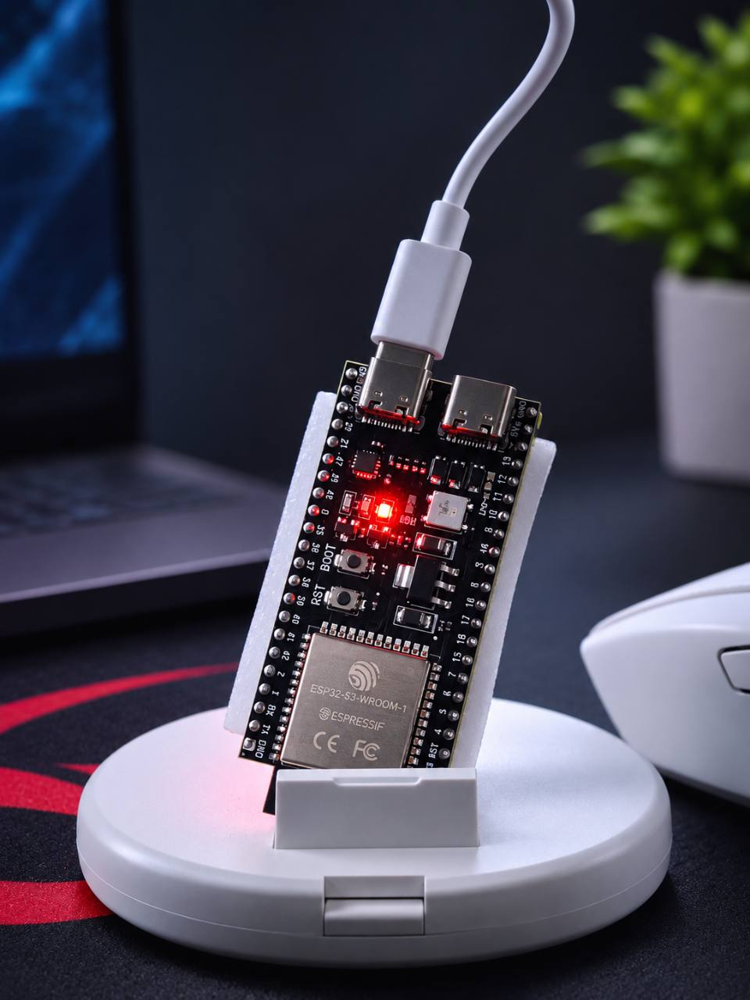

# Hardware baseline

Reconciled on 2026-11-26 against both NEXUS-S3 handoffs, the original v2.3 serial transcript, the installed board package, and historical files inspected in place.

| Item | Baseline |
|---|---|
| Target | ESP32-S3 N16R8, silicon revision v0.2 as reported, CH343 UART bridge |
| Qualified build | 160 MHz CPU, QIO 80 MHz menu, 16 MiB flash, 8 MiB OPI PSRAM |
| UART | Historical COM3 at 115200. Native USB used COM6 in separate tests. Port numbers can change. |
| AP reference | Channel 1, one client, 8.5 dBm after startup. The diagnostics ran with external airflow. |
| Diagnostics | Hardware Doctor v2.3 passed. The supplied transcript confirms 57 active HTTP responses, six BLE reads and six writes, 68 PSRAM passes, seven successful file reads, seven passing heap checks and 120 s recovery. |
| Thermal and memory | The v2.3 on-chip reading peaked at 37.3°C against a 38.3°C diagnostic cutoff. Internal free heap finished 20,692 bytes below its starting value. Passive cooling and repeated service cycles still need qualification. |

The cached v2.3 build used `app3M_fat9M_16MB`. Its partition binary and the historical Phase 9 device readback agree on all six entries and flags. Arduino's QIO 80 MHz menu uses a DIO image-header setting and a QIO bootloader variant, consistent with the ROM log.

| Partition | Offset | Size |
|---|---:|---:|
| `nvs` | `0x9000` | `0x5000` |
| `otadata` | `0xE000` | `0x2000` |
| `app0` | `0x10000` | `0x300000` |
| `app1` | `0x310000` | `0x300000` |
| `ffat` | `0x610000` | `0x9E0000` |
| `coredump` | `0xFF0000` | `0x10000` |

The full flash backup and pre-migration SPIFFS backup under the historical NEXUS-S3 directory match their recorded SHA-256 references. The Phase 10 crash ELF also matches its recorded digest, and its decoded trace is present. The original v2.3 client timing transcript is represented by the handoff summary. The standalone client script and original serial transcript are available locally. Backup restoration requires a separate qualification and approval.
