# PocketOS Screenshot Gallery

Mobile Chrome captures of PocketOS on NEXUS-S3 firmware `0.3.0-dev.1`. Select any screenshot to open it at full resolution.

[Back to the project README](../README.md)

## Dashboard and telemetry

| Device Overview | ChipVitals · Device | ChipVitals · Memory |
| :---: | :---: | :---: |
| <a href="screenshots/overview.png">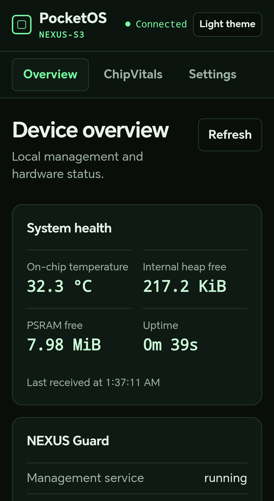</a> | <a href="screenshots/chipvitals-device.png">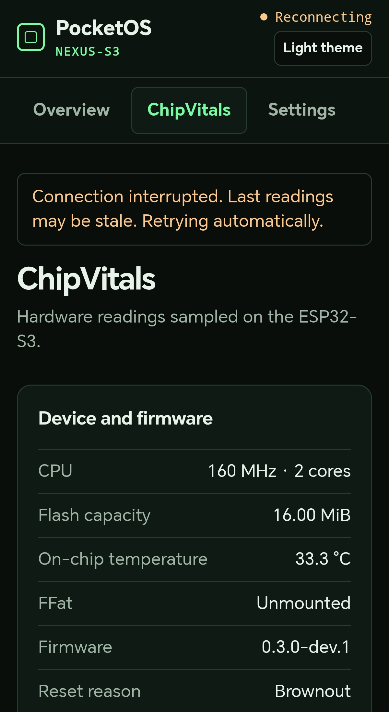</a> | <a href="screenshots/chipvitals-memory.png">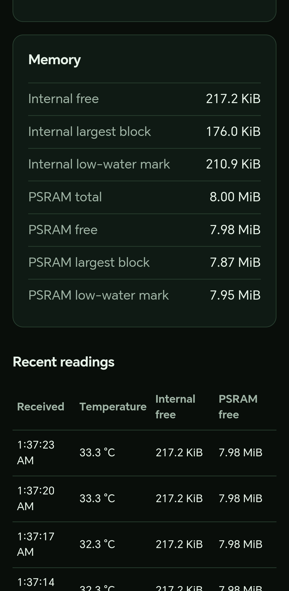</a> |
| Live system health and management status. | CPU, flash, firmware version, and reset reason. | Internal heap and PSRAM telemetry. |

## Local management

| Locked Controls | Standalone Field Mode |
| :---: | :---: |
| <a href="screenshots/settings-locked.png">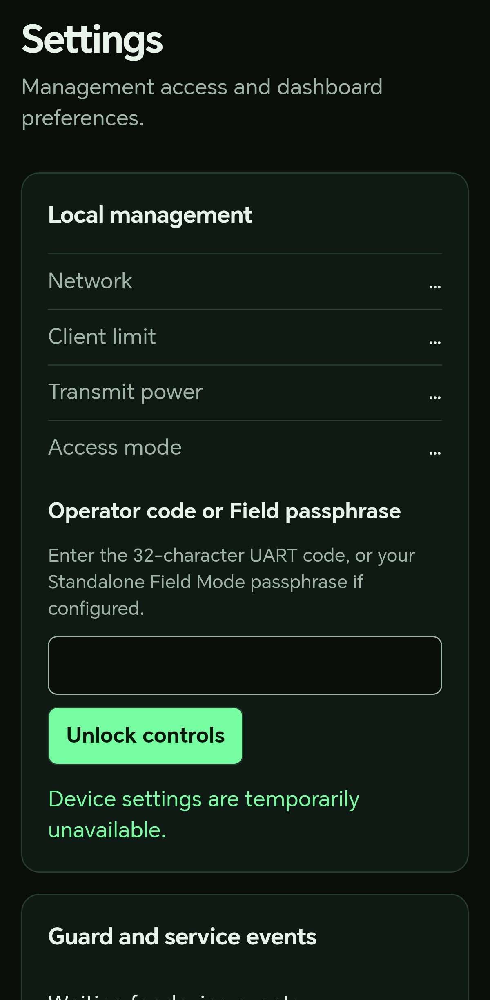</a> | <a href="screenshots/settings-field-mode.png">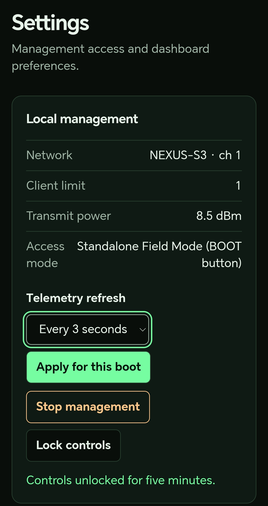</a> |
| The unlock prompt accepts a UART operator code or configured Field Mode passphrase. | The active session shows access mode, telemetry refresh, and management controls. |

## App catalog

| Catalog · First View | Catalog · Continued |
| :---: | :---: |
| <a href="screenshots/app-catalog-first.png">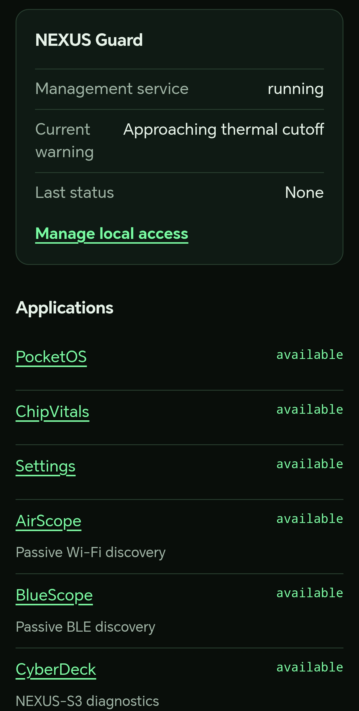</a> | <a href="screenshots/app-catalog-second.png">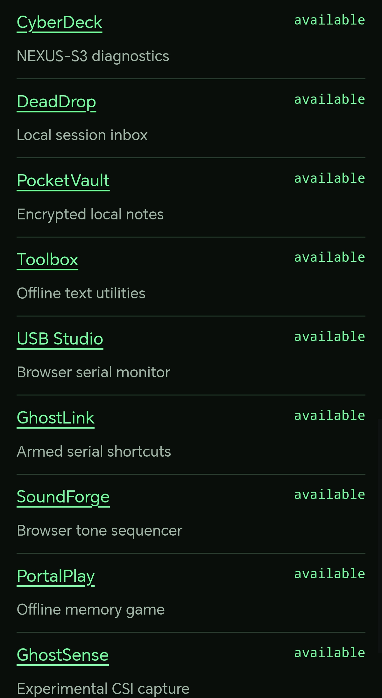</a> |

## Diagnostics and utilities

| CyberDeck | DeadDrop | Toolbox |
| :---: | :---: | :---: |
| <a href="screenshots/cyberdeck-checks.png">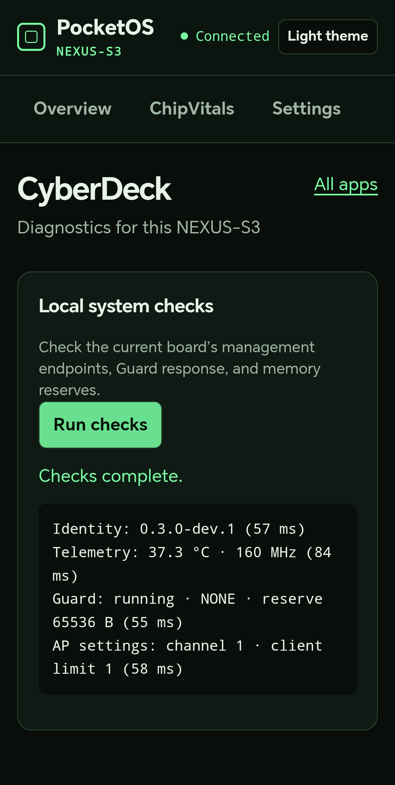</a> | <a href="screenshots/deaddrop-inbox.png">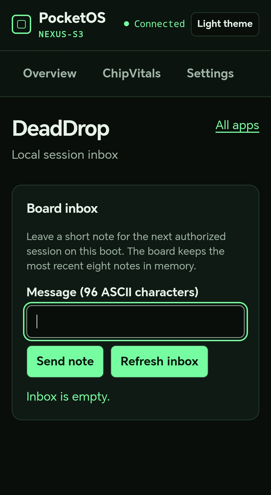</a> | <a href="screenshots/toolbox-base64.png">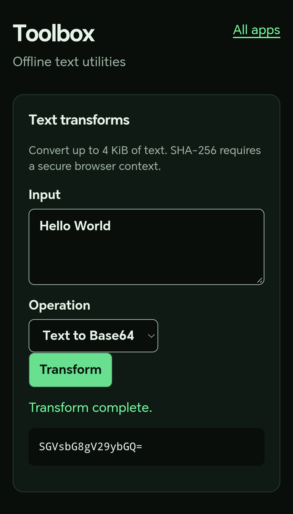</a> |
| Completed checks on the connected board. | A local session inbox for short notes. | A completed Base64 text conversion. |

## Audio, games, and learning

| SoundForge | PortalPlay | CyberArena |
| :---: | :---: | :---: |
| <a href="screenshots/soundforge-sequencer.png">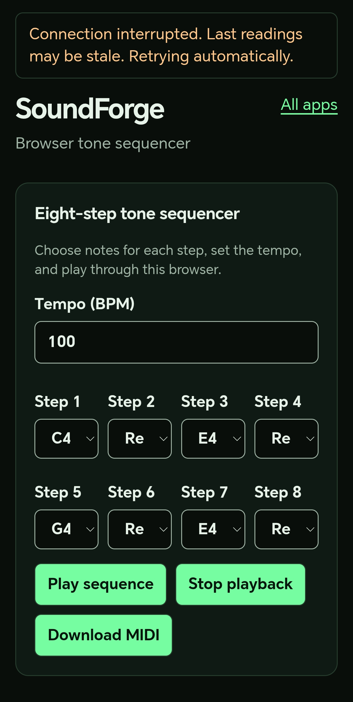</a> | <a href="screenshots/portalplay-memory.png">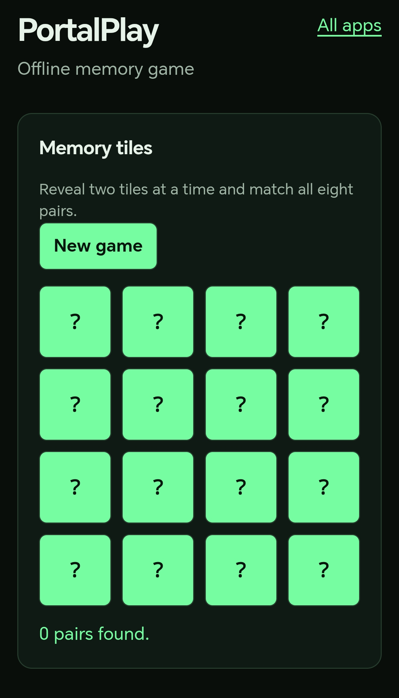</a> | <a href="screenshots/cyberarena-exercise.png">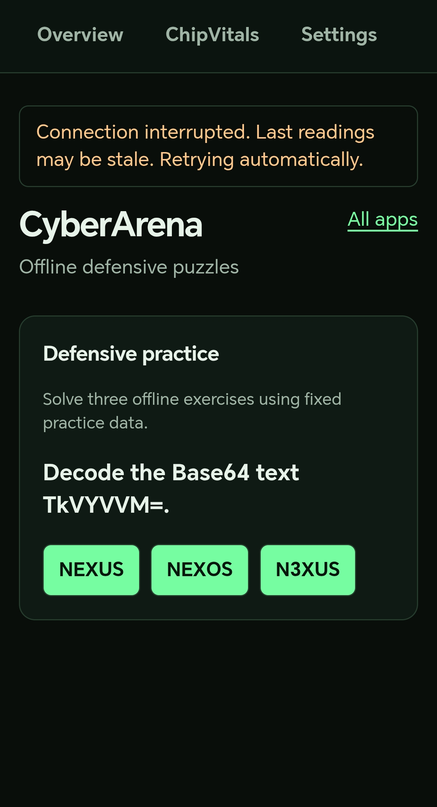</a> |
| Eight-step tone sequencer with tempo and MIDI export controls. | A 16-tile browser game ready to play during a connection interruption. | A Base64 decoding exercise using fixed practice data. |
